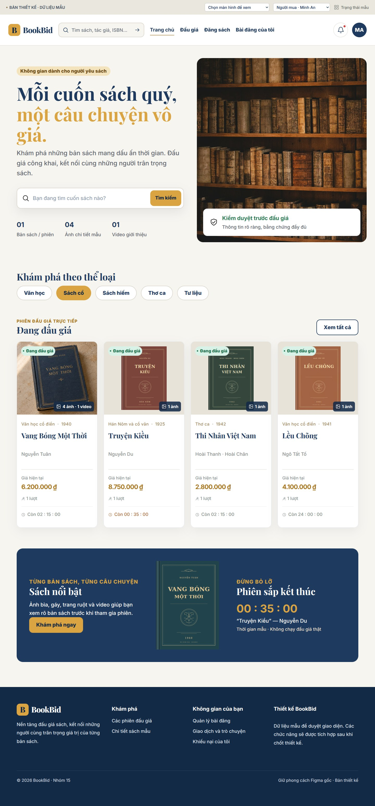

# BookBid — bản thiết kế theo giao diện Figma cũ

Bản thiết kế dùng **dữ liệu mẫu**, để Hải duyệt giao diện trước khi tích hợp vào dự án chính. Màu navy `#1f3a5f`, vàng `#d9a441`, nền kem `#f7f5f0`, font Inter/Playfair Display và kiểu thanh điều hướng được khôi phục theo mã giao diện gốc của repository.

Chữ nền **20px trên desktop, 18px trên mobile**; tiêu đề lớn, form/nút rộng. Có ảnh thư viện ở trang chủ, gallery của cùng một bản sách, ô tìm kiếm và chuông thông báo.

**Chỉ cập nhật `frontend-book`.** Nghiệp vụ đối chiếu từ [`my-project_book-auction-system/feat/Hai` tại b8f27a5](https://github.com/LeTuanHai-SVDHBD/my-project_book-auction-system/tree/b8f27a5149f2958d01d34540558768731087bd9a). Dự án chính sẽ được tích hợp sau khi chốt thiết kế.

## Xem ảnh giao diện



[Chi tiết sách và gallery](docs/previews/auction-desktop.jpg) · [Khung video](docs/previews/video-desktop.jpg) · [Thông báo mẫu](docs/previews/notifications-desktop.jpg) · [Kiểm duyệt](docs/previews/moderation-desktop.jpg) · [Thông báo Admin](docs/previews/admin-notifications-desktop.jpg) · [Menu Admin mobile](docs/previews/admin-menu-mobile.jpg) · [Trang chủ mobile](docs/previews/home-mobile.jpg) · [Chi tiết mobile](docs/previews/auction-mobile.jpg)

## Bố cục Admin đã chốt

Admin chỉ dùng **thanh điều hướng dọc**; chuông thông báo ở trên các mục quản trị, avatar/tên tài khoản ở cuối thanh và mở được trang tài khoản. Không có header ngang, lời mời đăng sách hoặc liên kết quản lý bài đăng cá nhân ở khu vực Admin. Trên màn hình từ 1100px trở xuống, bấm **Menu quản trị** để mở thanh dọc dạng ngăn kéo; có thể đóng bằng nút đóng, Escape hoặc chạm nền ngoài.

Giữ luồng bài bị từ chối → bổ sung/gửi duyệt lại. Nhãn hiển thị là **Bị từ chối**, không thêm trạng thái mới. Giữ **hai bên xác nhận giao dịch** và **Admin tiếp nhận khiếu nại**; vẫn có hai Admin mẫu để duyệt quyền đọc chat đúng người xử lý. Các thao tác vẫn chỉ minh họa bằng dữ liệu mẫu.

## Chạy trên Windows

Tại thư mục **frontend-book**:

```powershell
git switch main
git pull --ff-only origin main
npx.cmd pnpm@10.34.3 install --frozen-lockfile
npx.cmd pnpm@10.34.3 dev
```

Mở **http://localhost:8443**. Dùng Node.js 22.18+ hoặc 24. Trên macOS/Linux, thay `npx.cmd` bằng `npx`. Nếu chưa có mã nguồn, clone `https://github.com/LeTuanHai-SVDHBD/frontend-book.git` trước.

Nếu cổng 8443 đã được dùng:

```powershell
$env:PORT = "8444"
npx.cmd pnpm@10.34.3 dev
```

## Duyệt từng màn hình

- **Chọn màn hình để xem:** đi thẳng tới trang chủ, danh mục, sách đang đấu giá, kết quả, đăng sách, bài của tôi, AI riêng, giao dịch, khiếu nại hoặc Admin; chọn luôn tài khoản mẫu phù hợp.
- **Bộ chọn vai trò:** xem cách giao diện thay đổi với khách/người mua/chủ sách/Admin. Đây là lựa chọn trình bày, không phải đăng nhập thật.
- **Trạng thái mẫu:** chọn sẵn phản hồi đặt giá, trạng thái hai xác nhận/đánh giá, phân công khiếu nại và tình trạng AI.
- **Gallery phiên 101:** 4 ảnh cùng một cuốn sách — bìa, gáy, trang tên và trang ruột — cùng khung video. Không có bộ chọn số lượng hoặc trộn ảnh của nhiều cuốn sách.

Các nút **đặt giá, gửi bài, duyệt/từ chối, gửi tin, xác nhận, đánh giá, khiếu nại và chọn tệp** chỉ hiển thị ghi chú thiết kế. Không lưu bài mới, đổi giá, ghi tin nhắn, tạo tài khoản hoặc upload tệp. Đồng hồ là số liệu cố định. Chuyển trang/tab/gallery, gõ trong form và chọn trạng thái chỉ phục vụ xem bố cục.

Ô tìm kiếm trên thanh điều hướng/trang chủ và danh sách thông báo là **thiết kế để phát triển sau**, chưa có chức năng Backend. Xem [ghi chú chức năng dự kiến](docs/future-features.md).

## Phạm vi dữ liệu mẫu

Không gọi HTTP API, Socket.IO, Gemini, SQL Server, Redis hoặc Cloudinary. Không cần API key và không nhận mật khẩu/tệp thật. F5 khôi phục dữ liệu mẫu. Catalog chỉ lọc bộ dữ liệu mẫu nội bộ để xem bố cục kết quả/rỗng; chưa phải công cụ tìm kiếm hệ thống.

Ảnh gallery được tạo bằng imagegen cho bản thiết kế, không phải hồ sơ thẩm định hoặc ảnh xác nhận một ấn bản thật. Video là **khung trình phát minh họa, chưa gắn clip thật**. Font được lưu tại repo để hiển thị ổn định. Nguồn ảnh/font, prompt và giới hạn đối chiếu Figma được ghi ở [docs/design-sources.md](docs/design-sources.md).

Các quy tắc trình bày vẫn bám hệ thống hiện tại: chủ sách không có nút đặt giá; cooldown ẩn ô/nút nhập tiếp; giá kết thúc sớm và AI chỉ ở màn riêng của chủ/Admin; hai điểm AI độc lập và có NULL; đủ hai xác nhận mới hiện mẫu đánh giá cho người mua; chat khiếu nại chỉ hiện cho Admin được phân công khi hồ sơ đang xử lý.

## Kiểm tra

```powershell
npx.cmd pnpm@10.34.3 typecheck
npx.cmd pnpm@10.34.3 build
```

Kiểm tra Chromium gồm font thực tế, ảnh nội bộ, gallery/video, tìm kiếm/thông báo mẫu, nút nghiệp vụ không đổi dữ liệu và ma trận các trang desktop/mobile. Trang chủ/chi tiết được kiểm tra thêm ở 320px và 768px. Đây là kiểm tra **thiết kế**, không phải nghiệm thu Backend. Bộ mô phỏng xử lý nghiệp vụ và các test tương ứng ở bản trước đã được bỏ.

## Tài liệu và cấu trúc

[Checklist duyệt thiết kế](docs/design-review.md) · [Đối chiếu API để tích hợp sau](docs/api-map.md) · [Tìm kiếm và thông báo dự kiến](docs/future-features.md) · [Nguồn thiết kế và tài nguyên](docs/design-sources.md)

| Vị trí                                        | Nội dung                                                        |
| --------------------------------------------- | --------------------------------------------------------------- |
| `src/components`                              | Layout, nút, form, gallery, khung giá mẫu, chat và AI           |
| `src/pages`                                   | Màn hình theo nghiệp vụ hiện có                                 |
| `src/demo`                                    | Fixture và lựa chọn trạng thái trình bày; không xử lý nghiệp vụ |
| `src/domain`                                  | View model và điều kiện hiển thị                                |
| `src/contracts`                               | Hợp đồng tham chiếu, chưa có HTTP client                        |
| `src/styles/fonts.css`, `public/assets/fonts` | Font gốc, tự phục vụ trong repo, có giấy phép OFL               |
| `src/index.css`                               | Màu, chữ lớn và layout responsive                               |

React 19, TypeScript strict, Vite và Tailwind CSS 4 được giữ lại. Không thêm dependency runtime. `pnpm format` dùng Prettier. Các script/config Figma Make được giữ nguyên.
